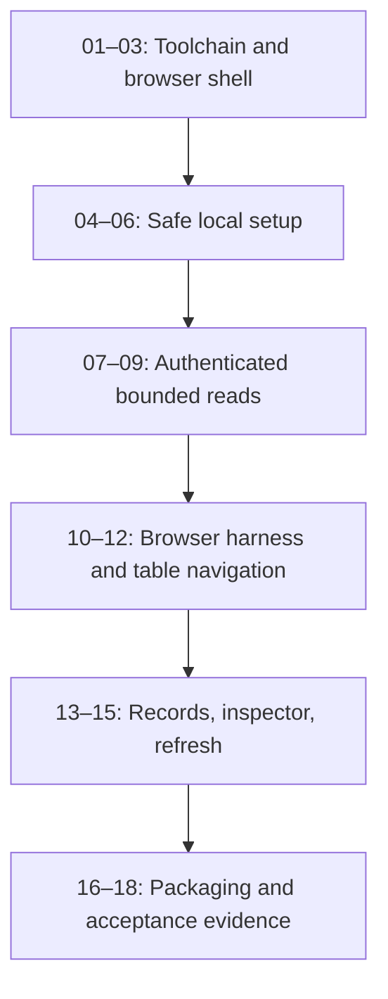

# Implementation Plan: Dexie Cloud Database GUI — Phase 1

Status: approved — user approved the plan and task list on 2026-11-19

Source spec: [approved Phase 1 specification](../spec/SPEC.md).
Task list target: [tasks/todo.md](todo.md). Both artifacts are approved; implementation follows the recorded checkpoints.

## Overview

Build a local Svelte database explorer with a Bun backend. The backend reads a configured schema export, obtains a globally readable token, and fetches one table at a time. The browser displays 50 records per page and an accessible record inspector. Enforce the approved 10,000-record / 10 MiB limits without truncation. No synchronization engine, local database, cloud mutation, or new production service is required.

The repository currently contains an initial Git commit, ignore rules, local skill configuration, and the approved spec. There is no application scaffold, dependency manifest, existing test suite, or incomplete implementation plan to preserve. Existing untracked skill files remain outside application changes.

## Architecture Decisions

### Process and trust boundary

- Use one repository and one package manifest. Bun runs the API and development supervisor; Vite builds the Svelte SPA. Do not add SvelteKit or a backend framework.
- Development: Vite listens on `127.0.0.1:5173`; the Bun API listens on `127.0.0.1:3001`. Use strict ports and proxy only `/api/` paths. Preserve the browser's origin information for backend validation.
- Built app: Bun serves `dist/` and the API on `127.0.0.1:3001`. Validate Host and browser-origin context before dispatching API requests. Use explicit allowed origins for each mode; never reflect arbitrary origins.
- Production application code accepts only the configured hosted HTTPS database URL and a schema file resolved at startup. Reject URL credentials, query strings, and fragments. Do not follow upstream redirects carrying credentials. Tests inject an upstream fetch implementation; they do not add a production switch that bypasses these rules.
- `.env` contains `DEXIE_DATABASE_URL`, `DEXIE_CLIENT_ID`, `DEXIE_CLIENT_SECRET`, and `DEXIE_SCHEMA_PATH`. Read only these server-side. Record/schema exports go under a documented gitignored `local/` directory; ignore `*.key` and local environment variants too.
- Vite must retain its default sensitive-file deny patterns and additionally deny `local/`, schema exports, and Dexie CLI configuration files on static/module routes. Disable its unfiltered public directory; application assets come through explicit source imports. A real local HTTP regression test covers this boundary.
- The backend can start in a configuration-error state so the browser can explain setup problems. A missing or invalid configuration must never trigger upstream requests.

### Local API contract

All responses are JSON with `Cache-Control: no-store`. Only GET reads are exposed. Reject mutation methods with 405 and unsupported routes with 404; do not forward arbitrary browser paths or query strings upstream.

| Local route                            | Successful result                                                            | Purpose                                                                                           |
| -------------------------------------- | ---------------------------------------------------------------------------- | ------------------------------------------------------------------------------------------------- |
| `GET /api/status`                      | `{ state: 'configured', databaseUrl }` or `{ state: 'unconfigured', error }` | Reports sanitized local setup; explicitly does not claim a successful cloud connection            |
| `GET /api/tables`                      | `{ tables: [{ name, primaryKey, keyPaths }] }`                               | Returns validated, alphabetically ordered schema metadata                                         |
| `GET /api/tables/:encodedName/records` | `{ records, fetchedAt }`                                                     | Returns one complete bounded table result; actual authentication/permission failures surface here |

Errors use `{ error: { code, message, retryable } }`, with stable codes for configuration, authentication, permission, timeout, network, invalid upstream data, and size limits. Messages come from local templates, not raw upstream bodies. The browser validates responses from `unknown` before using them. It computes record count from the complete returned array.

Implementation clarification at task 06: `/api/status` returns HTTP 200 for either configured or unconfigured local setup, since both are normal status results. An attempted table-list read while unconfigured returns HTTP 503 with the structured configuration error. This keeps normal setup reporting distinct from a failed data request.

`shared/contracts.ts` owns the record JSON value type, table metadata, limits, and API response/error contracts. Cloud JSON envelopes stay intact, including typed values and blob references. No date revival, blob download, or JSON transformation is needed to inspect raw returned values.

The record inspector reads the selected in-memory record. It needs no extra endpoint and makes no primary-key lookup. Handle custom and compound key metadata without assuming an `id` field; dotted key paths contribute their top-level root to the leading columns. Use own-property checks and safe key enumeration for arbitrary record field names.

### Upstream access

1. Validate environment configuration and the schema export before making requests.
2. Cache a token in backend memory, keyed to the sole configured database. Request exactly `ACCESS_DB` and `GLOBAL_READ` using `POST /token`; validate the token response and expiry. Coalesce simultaneous renewal attempts.
3. Read `GET /all/<encodedTableName>` only for names present in the loaded schema. Send no realm filter, so the result spans all realms.
4. Read the response incrementally with a 10 MiB byte budget, then parse and validate a JSON array of record objects. Accept exactly 10,000 records; reject 10,001. Keep typed envelopes unchanged.
5. Apply a 30-second request deadline through body consumption; cancel reading on a byte-limit violation or disconnected client. A token-expiry read may renew and retry once, with no retry loop for permissions or unrelated failures.
6. Return a fresh result without a server record cache. A failed refresh must not make stale records look current.

The underlying protocol remains the official [Dexie REST API](https://dexie.org/docs/cloud/rest-api). Schema setup uses the [CLI schema export](https://dexie.org/docs/cloud/cli#export). Task 07 verified the documented token fields and millisecond expiry interpretation against the [official authentication client](https://github.com/dexie/Dexie.js/blob/master/addons/dexie-cloud/src/authentication/authenticate.ts). Token acquisition has a separate 64 KiB response budget and the same 30-second deadline through body consumption. Confirm the actual payload with the eventual task 18 test-database smoke test; do not guess around an incompatible response.

### Browser behavior

- A compact desktop layout places searchable table navigation beside the record table; the inspector opens as a labeled panel/dialog. Use scoped styles and shared tokens, with horizontal scrolling for wide tables.
- Model setup/loading/loaded/empty/error states explicitly. Selecting a new table immediately releases the old records and closes the inspector.
- Use AbortController plus a request generation identifier. A delayed request must not publish results, errors, or timestamps after selection or refresh has moved on.
- Derive stable columns once per loaded result: primary-key roots first, then all other fields alphabetically. Render only the current page's 50 rows. Pagination never implies upstream paging or a stable snapshot across refreshes.
- Preserve original strings and typed JSON; use labeled previews for missing values, nulls, empty strings, and nested content. Long/deep record inspection must remain usable without discarding values; a readable escaped JSON view is an acceptable fallback to recursive expansion.
- Provide native buttons, labeled controls, visible focus, announcements for loading/errors, and predictable inspector focus restoration. No stored value is rendered with raw HTML.

## Dependency Baseline

Metadata was queried from the npm registry using `bun info <package> version peerDependencies --json` on 2026-11-19. These are proposed exact direct-dependency pins, not a claim that installation or runtime validation has already passed.

| Package/runtime              | Exact version |
| ---------------------------- | ------------- |
| Bun                          | 1.4.5         |
| svelte                       | 5.58.0        |
| vite                         | 8.3.8         |
| @sveltejs/vite-plugin-svelte | 7.3.1         |
| typescript                   | 6.0.3         |
| @types/bun                   | 1.4.4         |
| svelte-check                 | 4.7.8         |
| @playwright/test             | 1.65.1        |
| eslint                       | 10.15.0       |
| @eslint/js                   | 10.0.1        |
| typescript-eslint            | 8.73.0        |
| eslint-plugin-svelte         | 3.24.1        |
| prettier                     | 3.10.1        |
| prettier-plugin-svelte       | 4.2.0         |

TypeScript 6.0.3 satisfies both svelte-check's `^5 || ^6` peer range and typescript-eslint's `<6.1` range. The registry's latest TypeScript 7 is outside these ranges. The Svelte Vite plugin accepts Vite 8 and Svelte `^5.46.4`. Registry metadata: [svelte-check](https://registry.npmjs.org/svelte-check/latest), [typescript-eslint](https://registry.npmjs.org/typescript-eslint/latest), [Vite plugin](https://registry.npmjs.org/@sveltejs/vite-plugin-svelte/latest).

Install exact versions and commit `bun.lock`; do not use moving `latest` in the manifest. Use Bun explicitly for JavaScript tool entry points rather than relying on an installed Node executable through a shebang. Verify Vite, ESLint, svelte-check, TypeScript, and Playwright under Bun in foundation work. If a tool requires Node or a pin proves incompatible, document the evidence and revise the plan before adopting another runtime or weakening checks. No packages have been installed during planning.

## Dependency Graph and Delivery Order

The first foundation tasks establish the minimum scaffold; after that, each user-facing slice connects through the real local API. Upstream protocol safeguards are verified before browser data integration, so the first record-rendering slice already uses bounded, read-only access.

Tasks are indexed in [todo.md](todo.md), with acceptance criteria, dependencies, likely files, and focused verification. Checkpoints follow every three tasks. The user explicitly approved the detailed task list alongside this plan.

## Verification Checkpoints

| After tasks | Evidence required                                                                                                 |
| ----------- | ----------------------------------------------------------------------------------------------------------------- |
| 01–03       | Bun runs the pinned toolchain; the Svelte shell builds; static checks are configured                              |
| 04–06       | Setup states work; malformed schema/foreign origins/invalid Hosts fail closed; no cloud requests with bad setup   |
| 07–09       | Exact token scopes and allowed upstream paths; byte/row/deadline boundaries; sanitized failures; no mutations     |
| 10–12       | Deterministic browser harness exercises the real local API; table selection and empty-schema states work          |
| 13–15       | Heterogeneous records, paging, inspector, refresh, and stale-response handling work in Chromium                   |
| 16–18       | Built and dev workflows pass; accessibility and other-browser checks recorded; test-cloud smoke evidence recorded |

Every logic/behavior task starts with a failing test for the intended behavior, then implements the minimal change. Do not add tests that merely restate static configuration or cosmetic styling. At checkpoints run the applicable spec commands, review the evidence, and request the checkpoint's human review before the next phase. Do not mark a final criterion complete based solely on mocked results when the spec requires real-browser or cloud evidence.

## Risks and Mitigations

| Risk                                                                    | Impact                                         | Mitigation                                                                                                                                         |
| ----------------------------------------------------------------------- | ---------------------------------------------- | -------------------------------------------------------------------------------------------------------------------------------------------------- |
| Schema export is stale or uses an unsupported key definition            | Wrong table list or confusing display          | Validate every entry, preserve primary-key text, document re-export/restart; test deleted, custom, compound, dotted, and empty schemas             |
| REST payload or token-expiration assumptions differ from deployed Dexie | Cannot connect or renew correctly              | Validate against official protocol, fail clearly, then verify against a test database before acceptance                                            |
| Selected table exceeds limits or stalls                                 | Memory pressure or frozen UI                   | Bound response bytes during streaming, row count before publishing, and deadline through body consumption                                          |
| Local API is reachable from another website                             | Privileged records exposed                     | Loopback binding plus Host/origin checks, no permissive CORS, no redirect-based credential forwarding, tests in proxied and built modes            |
| Late responses race against selection/refresh                           | Wrong table appears                            | Abort requests and gate every state update on request generation                                                                                   |
| Bun differs from tool engine assumptions                                | Broken dev/build/test commands                 | Verify exact tools early under Bun; no silent Node fallback                                                                                        |
| Deep or wide records make inspection expensive                          | Poor responsiveness                            | Page the grid, compact previews, escaped JSON fallback for deep values; preserve the source data                                                   |
| No test-cloud access is available                                       | Final integration criterion remains unverified | Complete local fixtures and built app first; request a configured existing test database at the acceptance step, without creating remote resources |

## Parallelization

Execution is sequential by default; this plan does not authorize spawning agents. Once the shared contracts are stable, pure display helpers or setup documentation could be prepared independently of upstream protocol work if parallel work is later requested. Shared contracts, token handling, local routing, and UI request state must remain coordinated. There are no database migrations or remote provisioning tasks.

## Approval and Remaining Inputs

- The specification is approved, including schema-file setup and the size limits.
- The user approved this plan and its task checklist on 2026-11-19. Implementation is authorized; review at the listed checkpoints remains part of the approved workflow.
- No credentials are needed for plan or task review. Final acceptance will need local configuration for an existing test database and a matching schema export; supply credentials through local configuration, never through chat or source control.
- The shared definition-of-done reference linked by the planning skill is absent from this checkout. The approved spec's checks and success criteria remain the acceptance contract; no missing reference is treated as a waiver.
